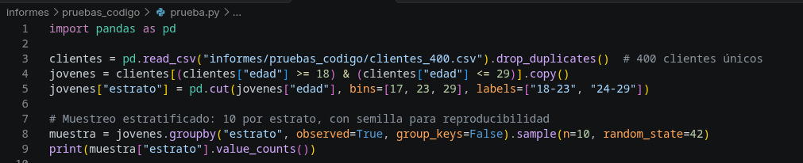

# Plantilla de diseño — Encuesta de satisfacción (hito 1)

**Equipo:** ___ · **Integrantes:** Jordan Sangucho, Josue Palma, Aidan Carrasco, Joel Champutiz, Emily Dias· **Fecha:** 25/10/2026
**Repositorio (fork):** https://github.com/josuepalma23/Lab3-Proyecto-EstII
**Enfoque del equipo (aprobado en clase):** Satisfacción y expectativas

Completa cada sección. Usa commits por sección; la historia del repositorio se revisa.

> **Formato del entregable:** exporta esta plantilla completada a PDF, con el enlace de tu fork en la carátula, y guarda el PDF en `informes/` del fork. Entrega el PDF y el enlace del fork en el aula virtual.

## 1. Objetivo de la encuesta

Estimar el porcentaje de personas satisfechas en el intervalo de 18 a 29 años en una escala del 1 al 5 con respecto a RetailAndina e identificar los beneficios que el encuestado espera sobre el programa de fidelización, con el objetivo de ser enviados a la gerencia para la posterior toma de decisiones.

## 2. Población objetivo

- **Población:** Personas de 18 a 29 años, residentes de la ciudad de Quito que compran en tiendas de consumo masivo de manera frecuente.
- **Límites y justificación:** 
  - Edad 18-29: Es el enfoque seleccionado, además de ser 18 años la edad mínima requerida para dar consentimiento informado y decidir compras por cuenta propia.
  - Residentes en la ciudad de Quito, para facilitar la recolección de información en la etapa de la encuesta.
  - Personas que compran de manera frecuente y al menos una vez al mes en tiendas de consumo masivo, garantiza que el encuestado tenga experiencia suficiente para opinar sobre el tema.
  - Las personas menores de 18 años y mayores de 29 años quedarán fuera de la encuesta, así como personas que no compran en tiendas de consumo masivo.

## 3. Método de muestreo

- **Método:** Muestreo estratificado por rango de edad (de 18 a 23 años y de 24 a 29 años), con selección aleatoria por cada uno de los estratos.
- **Tamaño y Justificación:** Se recolectan 20 respuestas en total, es decir, 10 por estrato y el equivalente a un rango de 3 a 6 respuestas por integrante del grupo. Esta pequeña muestra ayudará al grupo a realizar pruebas y detectar problemas, se estratifica con el objetivo de que ambos grupos de edad queden equitativamente representados con datos reales. En el caso de utilizar filas simuladas, estas serán marcadas como tal y en la columna **origen** y quedarán declaradas en el informe.
- **Selección de los participantes:** 
  - Cada integrante buscará entre sus contactos a personas que cumplan con el criterio planteado en la sección de la población objetivo y trabajará en su respectiva clasificación de acuerdo al estrato de edad.
  - De cada uno de los estratos se sorteará al azar a quién encuestar hasta completar la cuota de encuestados por integrante.
  - Se pedirá a cada encuestado un referido que a su vez cumpla con los requisitos establecidos para ampliar el alcance del experimento más allá del círculo cercano del integrante del grupo.
  - La encuesta se aplicará en modalidad virtual por medio de herramientas de formularios de Google o Microsoft durante la semana correspondiente al feriado del próximo 2 y 3 de noviembre, se registrará el número de personas referidas que no contestaron.
  - **Importante:** Al tratarse de contactos de los integrantes del grupo, esto también tiene relación con la conveniencia, por lo tanto, se expande este punto en la sección 5.

- Implementación en código:

## 4. Cuestionario (5–10 preguntas)

*Preguntas neutras, específicas, una idea por pregunta, opciones exhaustivas y excluyentes.*

| # | Pregunta | Tipo de variable | Dtype al cargar | Opciones / escala |
|---|---|---|---|---|
| 1 | | | | |
| 2 | | | | |
| ... | | | | |

*Nota: la columna "tipo de variable" usa la clasificación del cap. 3 (numérica continua/discreta, categórica binaria/ordinal). "Dtype al cargar" es cómo crees que llegará la columna en `df.dtypes`/`str()` (`int64`, `float64`, `str`/`object` según la versión de pandas). Pista: el dtype es una pista, no la clasificación — una ordinal puede llegar como `int`.*

## 5. Análisis de sesgos

*Identifica 2 problemas potenciales de esta encuesta y su mitigación.*

| Sesgo potencial | Mitigación |
|---|---|
| 1. | |
| 2. | |

## 6. Confidencialidad (RA3)

- Datos personales que se piden y por qué:
- Plan de anonimización (qué se quita o codifica antes de compartir):

## 7. Verificación con herramientas (Python/R)

*Escribe `scripts/verificacion_encuesta.py` (o `.R`): debe cargar `plantillas/encuesta_respuestas.csv` y reportar los tipos de cada columna, los datos faltantes por columna y la distribución de `satisfaccion_general` y `recomendaria`. Incluye la salida y responde:*

- ¿Coinciden los tipos con tu predicción de la sección 4?
- ¿Cuántos datos faltantes hay por columna?

*Ejecuta el script sobre el CSV final (separa con un filtro de la columna `origen` las filas reales de las simuladas): ¿qué resultado delataría un sesgo de **no respuesta** y cuál un sesgo de **respuesta**? Escribe tu interpretación usando solo las respuestas reales.*
